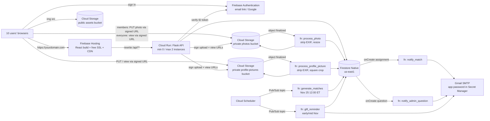

# Secret Santa → Google Cloud Platform: Architecture & Migration Plan

_Written 2026-10-15. Updated 2026-10-19 to add **member photo uploads**, and 2026-10-22 to add **profile pictures** (their own bucket). Both updates also account for the UI changes made since the first draft (first/last name split, Christmas theme, home page cards, questions bar on every page, the dashboard's leftover counter display removed). Updated 2026-10-25 with **your answers to the open decisions** (§7), which change anonymous questions, sign-in, matching, the photo gallery (now public) and photo retention (archived, not deleted). **Status:** Phase 0 is done, and the two repos were merged into one `Secret_Santa` repo on 2026-10-23. Phase 1 (backend) is done; Phase 2 (frontend) is next._

---

## 1. What the code does today (review summary)

| Area | Current state | What it means for the cloud |
|---|---|---|
| **Backend** (`flask_server/`) | Flask 3 blueprints: `users`, `gifts`, `matches`. Flask-SQLAlchemy on **SQLite** (`instance/secret_santa.db`, currently 4 users / 11 gifts of test data). Runs on port 8000 with `debug=True`. | SQLite can't be the database on serverless hosting: the container filesystem is temporary and every instance gets its own copy. The data layer has to change. |
| **User names** (`models.py`, `routes/users.py`) | The `users` table has `first_name` and `last_name` (split from a single `name` on 2026-10-18). The API requires both on create/replace and rejects blank names on `PATCH`. `last_name` is nullable only so the 4 older test rows (first name only) still load. The client shows the first name when addressing the user and `getFullName()` (`utils/userHelpers.js`) when identifying someone. | Carry the split into Firestore as `firstName` / `lastName`, both required for new profiles. Keep the API's JSON as `first_name` / `last_name` so the client doesn't change. |
| **Matching** (`matching.py`) | Shuffles everyone into one cycle, so nobody draws themselves. Pure function. | Can be reused as-is in both the API and a scheduled function. |
| **Frontend** (`client/`) | Create React App + MUI (custom Christmas theme in `src/theme.js`) + React Router. **15 hardcoded `http://localhost:8000` calls** across 8 files. `package.json` `proxy` points at port **5000** (wrong port). | Needs one API base URL. Once built it's plain static files, so it can be hosted for free. |
| **Auth** (`AuthContext.js`, `AuthModalContext.js`, `LoginForm.js`) | "Login" calls `GET /api/users?first_name=&email=` and saves the returned user object in `localStorage`. There are no passwords or tokens. The Log In / Sign Up pop-ups live in `AuthModalContext`, opened from both the header and the home page cards. Admin is decided **only in the browser** (`ADMIN_EMAIL` constant). | **This must be fixed before going public** (see §1a). |
| **Match reveal** (`UserDashboard/index.js`, `DashboardPrompt.js`) | The dashboard uses a hidden 1-second counter that calls `POST /api/matches/generate` from the browser once `counter >= 40`, so any visitor can trigger generation. The home page card uses a **different** rule, `isMatchRevealed()` in `dateHelpers.js` (Nov 25, 12pm EST), so the two can disagree. | The counter looks like a dev placeholder. Generation should become a **scheduled Cloud Function** on Nov 25, with the server enforcing the reveal date and both screens reading one `revealed` flag from the API. |
| **Questions** (`QuestionForm.js`, `QuestionsPrompt.js`, `QuestionsSection.js`) | The questions bar is rendered on every page by `App.js`, but the form doesn't submit anywhere and the admin view shows mock data. | Natural fit for a Firestore collection plus an **event-driven "email the admin" function**. |
| **Member photo uploads** (`PhotoUpload.js`, `utils/photoUpload.js`) | Signed-in users see "Upload your best Christmas photos…" on the home page. Picking images calls `uploadPhotos(files)`, which is **mocked**: it waits 1.2 s and reports success. Nothing leaves the browser and there's no screen to view photos yet. Family photos need a **private** bucket, uploads sent straight from the browser with **signed URLs**, and a function that strips location data and makes thumbnails. Processed photos are **viewable by anyone**, signed in or not (decision §7.5), through signed URLs the API hands out. See §2 and §5. |
| **Profile pictures** (`ProfilePictureInput.js`, `utils/profilePicture.js`, `UserDashboard/ProfileSlot.js`, `flask_server/profile_pictures.py`) | Sign Up (and Edit Your Information) has an optional picture. Flask checks it's a real JPEG/PNG/GIF/WebP of ≤ 5 MB, saves it to **local disk** (`instance/profile_pictures/`) and stores the filename in a `users.profile_picture` column. User JSON includes `profile_picture_url`. The dashboard shows your own picture on "Your Information" and your LB's picture on "Your Chosen LB's Information" after the reveal. With no picture, the full name shows in its place. | Profile pictures go in **their own private bucket**, separate from both the theme images and the members' Christmas photos. `profile_pictures.py` is the only server file that touches storage, so it's the piece to swap. |
| **Static images** | Three theme images are bundled from `client/src/assets/`: `background.png` (2.8 MB, transparent PNG), `ornament.png` (0.2 MB) and `christmas-tree.png` (0.8 MB, not currently rendered). `client/public` has only the CRA defaults. | Theme images go in a public Cloud Storage bucket. Convert `background.png` to WebP first. |
| **Repo layout** | One `Secret_Santa` repo (GitHub `SecretSanta`) holding `client/` and `flask_server/` with both histories. Merged 2026-10-23; `SecretSanta_backend` is archived. | §6 shows the layout after adding `functions/` and deploy config. |

### 1a. Security problems to fix before putting this on the internet
Real home addresses and family photos will be reachable at a public domain, so these are blockers, not nice-to-haves:

1. **`GET /api/users` returns every user's name, email and address to anyone.** The login form relies on this endpoint, so it can't simply be locked down without replacing login.
2. **`GET /api/matches` returns who has whom for everyone**, which spoils the whole game.
3. **Anyone can `POST /api/matches/regenerate`, `DELETE /api/users/<id>` or `PATCH` any user**, and anyone can replace, remove or download any user's profile picture through `/api/users/<id>/profile-picture`. The admin check is only on the client.
4. **Anyone can sign in as anyone** by knowing their first name and email.
5. **Possible XSS through gift URLs:** `DashboardCard.js` renders `<a href={field.url}>` with user-supplied URLs, so a `javascript:` URL would run in the gift-giver's browser. The server should accept only `http(s)://` URLs.
6. `CORS(app, origins="*")` and `debug=True` should not reach production.
7. `PATCH /api/users/<id>` now rejects blank first and last names, but still accepts empty strings for email and address. `PUT` validates all of them.
8. **Raw uploads and profile pictures must never be publicly readable.** Photos taken on phones usually carry **GPS coordinates in their EXIF data**, which for home photos means a home location. Both buckets must block public access, uploads must be limited by type, size and count, and location metadata must be stripped before anyone else can view a picture. (The local profile picture code stores files as uploaded, EXIF included, which is fine on a laptop but not online.) **Processed season photos are public by choice** (§7.5): anyone visiting the site can view them. That makes F6's EXIF stripping the only thing keeping home locations private, so Phase 5 tests it explicitly. Even so, the bucket itself stays private: visitors only see processed copies, through short-lived URLs the API signs.
9. **Questions must be truly anonymous** (§7.1), even to the admin, because a question may be about the admin's own match. Don't store who asked, don't log it, and keep request logs for the questions endpoint out of Cloud Logging (see 1.10).

---

## 2. Recommended GCP architecture



### Service choices and why

| Need | Service | Why this one | Rejected alternatives |
|---|---|---|---|
| **Host the React app on your domain** | **Firebase Hosting** (a Firebase product running in your GCP project) | Free custom-domain SSL and CDN. It can **rewrite `/api/**` to Cloud Run**, so the frontend and API share one origin and CORS goes away. Free tier: 10 GB stored, 360 MB/day transfer. | **Cloud Storage static website**: a custom domain over HTTPS needs an external HTTPS Load Balancer, which costs about **$18+/month (~$220/yr)** for the forwarding rule alone. That's not worth it at this size. |
| **Static images** | **Cloud Storage** bucket `secret-santa-assets`, Standard class, **us-east1**, publicly readable | Meets your requirement and fits inside the Always Free tier (5 GB-months, 100 GB egress/mo in us-east1/us-west1/us-central1). Images are served at `https://storage.googleapis.com/<bucket>/…`. | A CNAME such as `assets.yourdomain.com` pointing at GCS only works over **HTTP**. HTTPS on it needs the Load Balancer above. Use the `storage.googleapis.com` URL. |
| **Member photo uploads** | A **separate private** Cloud Storage bucket `secret-santa-photos` in **us-east1**, with public access prevention enforced. Signed-in members upload **directly to the bucket** using short-lived **V4 signed URLs** issued by the API. **Anyone**, signed in or not, views processed photos through signed read URLs from the public `GET /api/photos`. Photos are **kept across seasons** and move to **Archive** storage 90 days after upload (§7.6). | Photo bytes never pass through Cloud Run, so there's no 32 MiB request limit and no CPU time spent copying files. The API still decides who may upload what (type, size, per-user count). Keeping the bucket private while the gallery is public means raw uploads (EXIF included) are never reachable, nobody can list the bucket, and a deleted photo stops loading within the hour. A season's photos (10 members × 25 photos × ~1 MB after processing ≈ 250 MB) fit in the Always Free 5 GB-months while in Standard storage. After archiving they cost about $0.0012/GB-month, which is well under a cent a year per season. | **Uploading through Flask:** hits the 32 MiB request cap, is slower and bills CPU. **Firebase Storage client SDK with Storage security rules:** works and skips URL signing, but splits authorization between Python and a rules file, against the "browser talks only to the API" design in §4. **Putting photos in the public assets bucket:** anyone with a link could see family photos. |
| **Profile pictures** | **Its own private** Cloud Storage bucket `secret-santa-profile-photos` in **us-east1**, public access prevention enforced, using the same signed-URL pattern as photos. | You asked for profile pictures to be kept apart from the site's other pictures. A separate bucket also gives them their own IAM, CORS and lifecycle settings: they stay in Standard storage as long as the account exists, while season photos move to Archive storage each year. Each user has at most one current picture (≤ 5 MB before processing, ~50 KB after), so storage is negligible. | **A `profiles/` prefix in the photos bucket:** works, but mixes long-lived account data with per-season photos and their lifecycle rules. **The public assets bucket:** would make every member's face public. |
| **API** | **Cloud Run** (Flask in a container, gunicorn) | Keeps the Flask code you already have and **scales to zero**, so it costs $0 for the 10 months it's idle. Free tier: 2M requests, 180k vCPU-s and 360k GiB-s per month. Your November traffic would use well under 1% of that. | Rewriting every route as its own Cloud Function. That's possible, but it means 10+ deploys for zero cost benefit. Functions are better kept for the event-driven work below. |
| **Database** | **Firestore (Native mode), single region `us-east1`**, database ID **`secret-santa-database`** | Always Free: 1 GiB stored, 50k reads/day, 20k writes/day. Costs **$0 at this scale, all year**. It's also the **event source** for Firestore-triggered Cloud Functions. | **Cloud SQL**: the smallest instance runs about $8–10+/month and bills even when idle. You'd have to start and stop it every season. **SQLite on a GCS FUSE mount**: unsafe with concurrent writers and fragile. |
| **Auth** | **Firebase Authentication**, **passwordless email link only** (no Google sign-in, §7.2) | Free at this scale with no passwords to store. The Flask API verifies the ID token with `firebase-admin`. Admin is a server-side check (`ADMIN_EMAILS` env var or a custom claim). | Rolling your own password auth. |
| **Event-driven work** | **Cloud Run functions** (the current name for Cloud Functions 2nd gen), Python 3.12 | See §3. | — |
| **Schedules** | **Cloud Scheduler → Pub/Sub → function** | 3 jobs free per billing account, then $0.10/job/month. Pub/Sub's first 10 GiB/month is free. Going through Pub/Sub means scheduled functions never need a public HTTP URL. | HTTP-triggered functions with OIDC also work but add IAM setup. |
| **Secrets** (SMTP app password) | **Secret Manager** | 6 active secret versions free. | Environment variables in plain text. |
| **Email** | **Gmail SMTP with an App Password** (port 587) | $0, allows 500/day, and you already use Gmail. GCP has no native email service. Cloud Run blocks port 25, but 587 is fine. | SendGrid/Resend/Brevo free tiers are fine too if you'd rather use an API. |
| **Builds / images** | `gcloud run deploy --source` (Cloud Build + Artifact Registry) | Cloud Build includes 2,500 free build-minutes/month. Artifact Registry includes 0.5 GB free. **Set a cleanup policy** (keep the last 2 images), or old images will slowly add charges. | GitHub Actions is optional later. |
| **Domain** | Any registrar (Cloudflare Registrar, Porkbun, Squarespace…), using the registrar's free DNS | Firebase Hosting gives you the A/TXT records to add. | **Cloud DNS** costs $0.20/zone/month (~$2.40/yr). Use it only if you want DNS inside GCP too. |
| **Cost guardrails** | **Billing budget** ($5/mo, alerts at 50/90/100%) and **Cloud Run `--max-instances=2`** | The budget alerts you; max-instances caps runaway compute. | — |

**Use a single region: `us-east1`** for Firestore, Cloud Run, functions and all three buckets. It's close to your (Eastern-time) users, it's one of the Cloud Storage Always Free regions, Firestore-triggered functions have to run in the same region as the database, and Storage-triggered functions should run in the same region as their buckets.

### Estimated annual cost

| Item | Estimate |
|---|---|
| Domain name | **~$10–15/yr** (the only real cost) |
| Firebase Hosting, Cloud Run, Firestore, Cloud Storage (all three buckets), Functions, Pub/Sub, Logging | $0 (inside free tiers) |
| Cloud Scheduler | $0 with ≤3 jobs; each extra job is +$1.20/yr |
| Artifact Registry | $0 with a cleanup policy (otherwise a few cents/month) |
| Archived season photos | < $0.01/yr per season (Archive storage isn't in the free tier, but ~250 MB is tiny; viewing archived photos adds a retrieval fee of $0.05/GB, also fractions of a cent here) |
| **Total** | **≈ $12–20 / year** |

The GCP project needs **billing enabled** (Firebase's "Blaze" plan) for Cloud Run, Functions and Hosting→Run rewrites. Blaze still includes all the free quotas above. Photo uploads stay free as long as the per-user limits in §5 hold; the budget alert is the backstop if they don't.

### Off-season behavior (10 months of the year)
Nothing needs to be shut down. Cloud Run and the functions scale to zero, Firestore storage for 10 users is a few KB (free), and the Scheduler jobs only fire on their dates. An optional `config/season` Firestore document (`status: open | matched | closed`) lets the UI show "See you next November 🎄" outside the season. Photos are kept and stay in the gallery. A **bucket lifecycle rule** moves each photo to Archive storage 90 days after it was uploaded (Phase 0, step 13). They still load instantly; only the storage price drops.

---

## 3. Event-driven function opportunities

All of these live in a new `functions/` folder and deploy with `gcloud functions deploy … --gen2 --runtime=python312 --region=us-east1`.

| # | Function | Trigger | What it does | Replaces / adds |
|---|---|---|---|---|
| **F1** | `generate_matches` | Cloud Scheduler job `0 12 25 11 *`, time zone **America/New_York**, publishing to Pub/Sub topic `season-events` | Reads all users for the season and **last year's pairs only** (`seasons/{year-1}/assignments`; older seasons are ignored, §7.3), calls `generate_derangement` (shared with the API) with those pairs as exclusions, and **batch-writes** `seasons/{year}/assignments/{giverUid}`. Sets `seasons/{year}.status = "matched"` and `generation = 1`. **Idempotent:** if assignments already exist, it does nothing. If no valid draw exists, it writes nothing and emails the admin. | **Replaces** the browser-side "counter ≥ 40 → POST /generate" logic. |
| **F2** | `notify_match` | Firestore `document.created` on `seasons/{year}/assignments/{giverUid}` (Eventarc) | Emails each giver: "Your Secret Santa match is ready, log in to see it" (no name in the email, so the surprise isn't spoiled in an inbox preview). | **New.** It also fires on admin "Regenerate", and **re-emailing everyone is intended** (§7.4; you'll announce the change first). When `seasons/{year}.generation > 1`, the email says the matches were redrawn. Regenerate must delete the old assignment documents before creating the new ones (see 1.8), because overwriting an existing document doesn't count as "created" and wouldn't trigger this function. |
| **F3** | `notify_admin_question` | Firestore `document.created` on `questions/{id}` | Emails the admin the question text only. There's nothing identifying the asker to include (§7.1). | **Wires up** the currently mock `QuestionForm` / `QuestionsSection`. |
| **F4** | `gift_reminder` | Cloud Scheduler (e.g., `0 10 15,22 11 *` ET) → Pub/Sub | Emails users whose `gifts` list is empty: "Add your wish list before matches on Nov 25." | **New.** |
| _F5 (optional)_ | `close_season` | Scheduler, Jan 15 → Pub/Sub | Sets `config/season.status = "closed"` and keeps last season's assignments for "no repeat match" logic next year. | Fold it into F4's job (dispatch on a Pub/Sub message attribute) to stay at 3 Scheduler jobs. |
| **F6** | `process_photo` | Cloud Storage `object.finalized` on the **photos** bucket | Ignores any object outside `uploads/` (its own output lands in the same bucket and would otherwise retrigger it). Opens the upload with Pillow, which also rejects files that aren't really images. **Strips all EXIF metadata, including GPS location**, and fixes rotation. Writes a display copy (max 1600 px) and a thumbnail (400 px) as WebP, then **deletes the original**. Sets `photos/{id}.status` to `"ready"` (or `"rejected"`). **Idempotent:** skips photos already marked ready. | **Now required**, because of the photo upload feature. It replaces the earlier optional `optimize_image` idea for the assets bucket; theme images are few enough to optimize by hand. |

| **F7** | `process_profile_picture` | Cloud Storage `object.finalized` on the **profile-pictures** bucket | Same safety steps as F6, using the same shared image code: ignore objects outside `uploads/`, verify the image, **strip EXIF/GPS**, fix rotation. Center-crop to a square, resize to 512 px WebP at `avatars/{uid}/{pictureId}.webp`, delete the original and the user's previous avatar, then set `users/{uid}.profilePicturePath`. **Idempotent:** skips if `profilePicturePath` already points at this picture. | **New**, for profile pictures. A second deploy of the same code would also work, but a separate entry point keeps the square crop and the "replace previous avatar" step out of F6. |

Scheduler job count: **F1, F4 (also handling F5), and one spare**, which keeps you inside the 3 free jobs. F6 and F7 are event-triggered, so they don't use Scheduler jobs.

---

## 4. Firestore data model

```
config/
  season               { status: "open"|"matched"|"closed", revealAt: Timestamp, year: 2026 }
  invites              { emails: ["a@x.com", ...] }        # allowlist of the 10 participants

users/{uid}            # doc id = Firebase Auth uid (email uniqueness is handled by Auth)
  firstName, lastName, email, address, createdAt, updatedAt
  profilePicturePath: "avatars/{uid}/{pictureId}.webp" | null   # in the profile-pictures bucket
  gifts: [ {name, url, notes} ... ]                        # max 4; array index = position

seasons/{year}
  status, generatedAt, generation: 1          # +1 on each admin regenerate
seasons/{year}/assignments/{giverUid}
  receiverUid, createdAt, notifiedAt

questions/{id}
  text, createdAt, answered: bool             # deliberately no askerUid (§7.1)

photos/{photoId}
  ownerUid, season: 2026, status: "pending"|"ready"|"rejected",
  contentType, sizeBytes, createdAt, processedAt,
  displayPath: "display/2026/{uid}/{photoId}.webp",
  thumbPath:   "thumbs/2026/{uid}/{photoId}.webp"
  # the raw upload lives at uploads/2026/{uid}/{photoId} until F6 deletes it
  # display/ and thumbs/ objects move to Archive storage 90 days after they're created
```

Why it's shaped this way:
- **Gifts are embedded in the user document** because there are at most 4 per user, and `replace_gifts` already does a full replace. One read gets the profile and wish list together.
- **Names are stored as `firstName` / `lastName`** to match the current split. The API keeps returning `first_name` / `last_name`, so the client's forms and `getFullName()` stay as they are.
- **Assignments are stored per season (year)**, so regenerating next year doesn't overwrite history, and matching can read last year's pairs to avoid repeating them.
- **Questions have no asker field at all.** Anonymity comes from never having the data, not from hiding it in the admin screen.
- Assignments are **not** stored on the user document, so reading a profile can't leak a match.
- **The profile picture is a single path on the user document**, because each user has at most one. The API turns it into a short-lived signed `profile_picture_url` only for people allowed to see it, so a stored URL never leaks or goes stale.
- **Photos are their own top-level collection** keyed by photo ID, with `ownerUid` and `season`. Listing a season's gallery is one query, a per-user upload cap is a count query, and owners or the admin can delete a single photo. `ownerUid` is never sent to signed-out visitors.
- **Firestore security rules: deny all client access.** The browser only talks to the Flask API, which uses the Admin SDK. That keeps every authorization rule in one Python place. The photos and profile-pictures buckets follow the same rule: the browser can only reach them through URLs the API signs.

---

## 5. Step-by-step code changes

### Phase 0: GCP project setup (console/CLI, no code) ✅ done, except step 13
1. Create GCP project `secret-santa-<suffix>`, link billing, and **create a $5/month budget alert**.
2. Add Firebase to the project (console.firebase.google.com → "Add project" → select the existing GCP project) and upgrade to Blaze.
3. Enable APIs: Cloud Run, Cloud Functions, Cloud Build, Artifact Registry, Firestore, Eventarc, Pub/Sub, Cloud Scheduler, Secret Manager, and **IAM Service Account Credentials** (the API signs photo URLs through it).
4. Create a Firestore database: **Native mode, location `us-east1`**. It was created as **`secret-santa-database`**, not `(default)`, so every client must name it (see 1.3). It's the project's first database, so it still gets the free quota.
5. Enable the Firebase Auth provider **Email/Password → Email link (passwordless sign-in)** only (§7.2). If Google was enabled earlier, disable it.
6. Create bucket `gs://secret-santa-assets` in `us-east1` with uniform bucket-level access, and grant `allUsers` → `Storage Object Viewer`. This holds the theme images only.
7. Create the **private photos bucket**:
   - `gcloud storage buckets create gs://secret-santa-photos --location=us-east1 --uniform-bucket-level-access --public-access-prevention`
   - Add a **CORS policy** so the browser can `PUT` uploads to signed URLs: origins `http://localhost:3000` (and later your domain, see Phase 4), methods `PUT` and `GET`, response headers `Content-Type` and `x-goog-content-length-range`, `maxAgeSeconds: 3600`. Apply with `gcloud storage buckets update gs://secret-santa-photos --cors-file=photos-cors.json`.
   - Lifecycle rules: see step 13.
8. Create the **private profile-pictures bucket** the same way, kept separate from the assets and photos buckets:
   - `gcloud storage buckets create gs://secret-santa-profile-photos --location=us-east1 --uniform-bucket-level-access --public-access-prevention`
   - Apply the same CORS file (`--cors-file=photos-cors.json`), so browser uploads from sign-up and Edit work.
   - Optional: the same 1-day lifecycle rule on `uploads/` for pictures F7 never processed. No rule on `avatars/`: those live as long as the account.
9. Create dedicated service accounts: `secret-santa-api` (Cloud Run) and `secret-santa-fns` (functions). On the photos and profile-pictures buckets only, grant both `roles/storage.objectAdmin`. Grant `secret-santa-api` **`roles/iam.serviceAccountTokenCreator` on itself**, so it can sign URLs without a downloaded key file.
10. Grant the Cloud Storage service agent (`service-<project-number>@gs-project-accounts.iam.gserviceaccount.com`) `roles/pubsub.publisher`. Storage-triggered functions (F6, F7) need this.
11. Store the Gmail app password in Secret Manager as `smtp-password`.
12. Create Pub/Sub topic `season-events`.
13. **(Added 2026-10-25, still to do.)** Give the photos bucket its lifecycle rules. Save this as `photos-lifecycle.json` in the repo root:
    ```json
    {
      "rule": [
        {
          "action": {"type": "Delete"},
          "condition": {"age": 1, "matchesPrefix": ["uploads/"]}
        },
        {
          "action": {"type": "SetStorageClass", "storageClass": "ARCHIVE"},
          "condition": {
            "age": 90,
            "matchesPrefix": ["display/", "thumbs/"],
            "matchesStorageClass": ["STANDARD"]
          }
        }
      ]
    }
    ```
    Apply it with `gcloud storage buckets update gs://secret-santa-photos --lifecycle-file=photos-lifecycle.json`.
    - Rule 1 deletes raw uploads that F6 never processed after a day.
    - Rule 2 moves each photo's display copy and thumbnail to Archive **90 days after upload**. `age` counts from when the object was created, and F6 creates those copies within seconds of the upload, so in practice that's 90 days from upload. It's one permanent rule with no yearly changes. Lifecycle rules run in the background, so the move can take up to a day.
    - A lifecycle file **replaces** the bucket's whole lifecycle config, so keep both rules in this one file.
    - Archive objects have a 365-day minimum storage charge, so deleting an archived photo early bills the remaining days. At ~250 KB per photo that's fractions of a cent.
    - The profile-pictures bucket only needs the `uploads/` rule (rule 1). Save it as its own file and apply it the same way.

### Phase 1: Backend (`flask_server/`)

**Before you start:**
- **Install the local tools:** Python 3.12 (`brew install python@3.12`), Node 20+ (the Firebase CLI needs it; the machine currently has Node 16), the Firebase CLI (`npm install -g firebase-tools`), and Java 21 for the Firestore emulator (`brew install openjdk@21`). Then run `gcloud auth application-default login`.
- **Set up the emulators** from the `Secret_Santa/` root with `firebase login`, then `firebase init firestore emulators`. Pick the existing project and enable the Auth, Firestore, Functions, Pub/Sub, Storage and Hosting emulators. This creates `firebase.json`, `.firebaserc` and `firestore.rules` now, because step 1.15 needs them. Phase 4 only adds the `hosting` section.

| Step | File(s) | Change |
|---|---|---|
| 1.1 | `Pipfile` | Remove `flask-sqlalchemy`. Add `firebase-admin` (includes the Firestore client), `google-cloud-storage` (signed URLs) and `gunicorn`. **Change `python_version` from `3.10` to `3.12`**, since Python 3.10 reaches end of life this month (Oct 2026). Generate a `requirements.txt` (`pipenv requirements > requirements.txt`) for the container build. |
| 1.2 | **new** `Dockerfile`, `.dockerignore` / `.gcloudignore` | `python:3.12-slim`, `pip install -r requirements.txt`, `CMD exec gunicorn --bind :$PORT --workers 1 --threads 8 "server:create_app()"` (the app factory, so tests can build the app with their own settings). Ignore `instance/`, `__pycache__`, `.git`. |
| 1.3 | `server.py` | Remove the SQLAlchemy config and `db.create_all()`. Initialize `firebase_admin` once. Read settings from env vars (`ADMIN_EMAILS`, `GOOGLE_CLOUD_PROJECT`, `FIRESTORE_DATABASE`, `ALLOWED_ORIGINS`, `PHOTOS_BUCKET`, `PROFILE_PICTURES_BUCKET`). The values for this project are `GOOGLE_CLOUD_PROJECT=secret-santa-511801`, `FIRESTORE_DATABASE=secret-santa-database`, `PHOTOS_BUCKET=secret-santa-photos` and `PROFILE_PICTURES_BUCKET=secret-santa-profile-photos`. **Create the Firestore client with `firestore.client(database_id=FIRESTORE_DATABASE)`.** Without it, the client connects to `(default)`, which doesn't exist in this project. The functions in Phase 3 do the same. Restrict CORS to `http://localhost:3000` in dev only (prod is same-origin through Hosting). Keep `app.run(debug=True)` only under `__main__` for local use. Delete the dummy `/api/about` route, or make it return real content. |
| 1.4 | `models.py` → **replace with** `repository.py` | A thin Firestore data layer: `get_user(uid)`, `list_users()`, `create_user(uid, …)`, `update_user(uid, fields)`, `delete_user(uid)`, `set_gifts(uid, gifts)`, `get_assignment(year, uid)`, `write_assignments(year, mapping)` (batched), `list_assignments(year)`, plus photos: `create_photo(…)`, `get_photo(id)`, `list_photos(season, status="ready")`, `list_photo_seasons()`, `count_photos(uid, season)`, `delete_photo(id)`, and `create_question(text)` (no asker argument). Serializers map Firestore's `firstName`/`lastName` back to the current `first_name`/`last_name` JSON, and `profilePicturePath` to a signed `profile_picture_url` (or `null`), so response shapes stay what the client expects today. |
| 1.5 | **new** `auth.py` | `@require_user` decorator: reads `Authorization: Bearer <idToken>`, calls `firebase_admin.auth.verify_id_token`, and puts `uid`/`email` on `flask.g`. `@require_admin` checks `g.email in ADMIN_EMAILS`. `@optional_user` does the same when a token is present and otherwise continues signed out. It's used only by the public `GET /api/photos`. |
| 1.6 | `routes/users.py` | Change `<int:user_id>` to `<user_id>` (Firestore IDs are strings). **Add** `GET /api/me`, `POST /api/me` (finish signup: **first name, last name** and address, all required, checked against the `config/invites` allowlist) and `PATCH /api/me`. Make `GET /api/users` and `PATCH`/`PUT`/`DELETE /api/users/<id>` **admin-only**. **Remove** the `?first_name=&email=` lookup that login uses today. `PATCH` already rejects blank names; extend that to email and address. When an admin deletes a user, also delete that user's assignment, photos and profile picture, and warn if matches already exist. |
| 1.7 | `routes/gifts.py` | Store the gift list as an array on the user document. Keep the `MAX_GIFTS = 4` validation. **Accept only `http://`/`https://` URLs** (fixes the XSS). Routes become `/api/me/gifts` (GET/PUT, signed-in user only). An admin can read anyone's gifts through the admin overview. |
| 1.8 | `routes/matches.py` | **Remove** the public `POST /generate`. **Add** `GET /api/matches/me`: before `config/season.revealAt` it returns `{revealed: false, reveal_at}`; after, it returns `{revealed: true, reveal_at, receiver: {first_name, last_name, address}, gifts: [...]}` (fixes the client's extra round-trip for the assignee's gifts). Make `GET /api/matches` and `POST /api/matches/regenerate` **admin-only**. Regenerate re-emails everyone through F2 (§7.4), so it must: (1) draw new pairs, excluding last year's, (2) **delete** the current `seasons/{currentYear}/assignments` documents in one batch, (3) **create** the new ones in a second batch so F2 sees `document.created`, and (4) increment `seasons/{year}.generation`. If no valid draw exists, return `409` and change nothing. The optional `{"ignore_exclusions": true}` body lets the admin accept a repeat pair in that case. |
| 1.9 | `matching.py` | Keep the single-cycle shuffle, and **add an `exclusions` parameter** (a set of `(giver, receiver)` pairs). Callers pass **last year's pairs only**, read from `seasons/{year-1}/assignments`. Older seasons are never read, and if last year has no assignments there are no exclusions (§7.3). Reshuffle until no excluded pair appears, up to e.g. 1,000 attempts, then raise `NoValidMatchError`. For 3 or more people a valid draw almost always exists. With 2 people the only possible draw is last year's, so it always fails. Use `random.SystemRandom()`. Move it into a small shared package (e.g., `shared/matching.py`) so `functions/` imports the same code (see §6). |
| 1.10 | **new** `routes/questions.py` | `POST /api/questions` (signed in, which keeps out spam) creates `questions/{id}` with **only** `text`, `createdAt` and `answered`, and triggers F3. **Never store or log the asker's uid or email** (§7.1): no `askerUid`, no log lines in this route that include `g.uid`/`g.email`, and no uid in error messages. Cloud Run's request logs record each request's time and IP address, which the admin (as project owner) could match against other activity. Add a **Cloud Logging exclusion** on the `_Default` sink for `httpRequest.requestUrl:"/api/questions" AND httpRequest.requestMethod="POST"` so those entries are never stored. `GET /api/questions` (admin). |
| 1.11 | **new** `routes/photos.py` and `storage.py` | **`POST /api/photos/uploads`** (signed in). Body: `{files: [{filename, contentType, size}]}`, up to 10 per request. Validates each file: content type in `image/jpeg`, `image/png`, `image/webp`, `image/heic`; size ≤ 15 MB; the user stays under the per-season cap (e.g., 25 photos). For each file it creates `photos/{id}` with `status: "pending"` and returns `{photoId, uploadUrl, headers}`. `uploadUrl` is a **V4 signed `PUT` URL** for `uploads/{season}/{uid}/{photoId}`, valid for 15 minutes and bound to the declared `Content-Type` and to `x-goog-content-length-range: 0,15728640`, so the browser can't upload a different type or a bigger file.<br/>**`GET /api/photos?season=YYYY`** is **public: no sign-in needed** (§7.5, `@optional_user`). It returns that season's `ready` photos (default: the current season) with **signed `GET` URLs (1 hour)** for the thumbnail and display copy, plus `seasons`, the list of years that have photos, for a season picker. Photos from every past season stay available. Signed-out responses include no owner details. Signed-in responses add the owner's first name and `canDelete` (owner or admin). **Cache the signed list in memory for ~10 minutes per season**: each signature is an IAM API call on Cloud Run, and a public page shouldn't make hundreds of them on every visit.<br/>**`DELETE /api/photos/<id>`** (owner or admin) deletes the objects and the document.<br/>`storage.py` holds the signing code. On Cloud Run there's no key file, so refresh the default credentials and pass `service_account_email=` and `access_token=` to `blob.generate_signed_url(version="v4", …)`. That's why the API's service account needs Token Creator on itself (Phase 0, step 9). No "upload complete" endpoint is needed: F6 marks a photo ready once the object lands. |
| 1.12 | `profile_pictures.py`, `routes/users.py` | Replace the local-disk code with the profile-pictures bucket, reusing `storage.py`'s signing:<br/>**`POST /api/me/profile-picture`** (signed in) takes `{contentType, size}` (JPEG/PNG/GIF/WebP/HEIC, ≤ 5 MB) and returns a V4 signed `PUT` URL for `uploads/{uid}/{pictureId}`, valid 15 minutes. F7 processes it and sets `profilePicturePath`.<br/>**`DELETE /api/me/profile-picture`** deletes the avatar object and clears the path.<br/>`profile_picture_url` becomes a **signed `GET` URL (1 hour)**, included only for the user themself, the admin, and the person matched to them **after the reveal** (in `GET /api/matches/me`). It's `null` for everyone else.<br/>**Remove** the local-only `GET`/`PUT`/`DELETE /api/users/<id>/profile-picture` routes and the `users.profile_picture` column. |
| 1.13 | **new** `routes/admin.py` | `GET /api/admin/overview` returns users, their gifts, assignments and photo counts in **one** call, replacing the N+1 `fetch` loop in `Admin/index.js`. Questions aren't part of it and never carry an asker. |
| 1.14 | **new** `scripts/migrate_sqlite_to_firestore.py` (optional) | A one-time copy of the existing SQLite rows to Firestore (`first_name` → `firstName`, `last_name` → `lastName`). It's probably unnecessary since the current data is test data, and 4 of the rows have no last name. Local profile pictures in `instance/profile_pictures/` aren't copied; members can re-add them. |
| 1.15 | Local dev | Copy `flask_server/.env.example` to `flask_server/.env` (`pipenv run` loads it) and run `firebase emulators:start --only auth,firestore` from the repo root. The `.env` points Flask at the emulators, sets `PYTHONPATH=..` so `shared/` is importable, allows `http://localhost:3000`, and sets **`STORAGE_MODE=local`**. In local mode, signed upload/view URLs point at a dev-only Flask route (`/api/dev-storage/...`) that stores files under `instance/dev_storage/` and stands in for F6/F7 (marks photos ready, sets the avatar, without resizing or EXIF stripping). The client uses the same upload flow in dev and production, so no `REACT_APP_PHOTO_UPLOADS=mock` or separate dev bucket is needed. To test real signed URLs locally, grant yourself Token Creator on `secret-santa-api` and run `gcloud auth application-default login --impersonate-service-account=secret-santa-api@secret-santa-511801.iam.gserviceaccount.com` with `STORAGE_MODE=gcs`. |

**Phase 1 status (2026-10-25): done.** Where the code differs from the table above:
- **JSON keys are snake_case everywhere**, requests included: uploads take `{files: [{filename, content_type, size}]}` and return `[{photo_id, upload_url, headers}]`; `POST /api/me/profile-picture` takes `{content_type, size}` and returns `{picture_id, upload_url, headers}`; the gallery returns `{season, seasons, photos: [{id, thumb_url, display_url, created_at}]}`, plus `owner_first_name` and `can_delete` for signed-in members; `GET /api/matches/me` uses `reveal_at`.
- **The gallery cache** is used by signed-out visitors only. Signed-in requests always rebuild it, so a member sees their own upload as soon as it's processed, and visitors see it within 10 minutes.
- **Photo helpers** live in `flask_server/photo_storage.py` (beside `profile_pictures.py`); `storage.py` holds the shared signing and local-mode code.
- **`shared/matching.py`** is the only copy. Locally it's found through `PYTHONPATH=..`; before deploying, `scripts/sync_shared.sh` copies `shared/` into `flask_server/` (and `functions/`), and those copies are gitignored (see Phase 4, step 2).
- **Deleting a user** (admin) also deletes their Firebase Auth account, photos and profile pictures, and their assignment, with a warning to regenerate if matches exist. `POST /api/users` was removed; profiles are created through `POST /api/me`.
- **The Cloud Logging exclusion** `anonymous-questions` was added to the `_Default` sink on 2026-10-25.
- **`scripts/migrate_sqlite_to_firestore.py`** is a dry run by default (`--write` to save) and refuses to write to the real project without `--production`.

### Phase 2: Frontend (`client/`)

| Step | File(s) | Change |
|---|---|---|
| 2.1 | **new** `src/api/client.js` | One `apiFetch(path, options)` that prefixes the relative `/api` path, adds `Authorization: Bearer ${await auth.currentUser.getIdToken()}`, and parses JSON and errors in one place. |
| 2.2 | 8 files with **15** `http://localhost:8000` calls: `LoginForm.js`, `SignupForm.js`, `EditProfileForm.js`, `Admin/EditUserForm.js`, `Admin/index.js` (5), `UserDashboard/index.js` (4), `Main/index.js`, `About/index.js` | Replace each with `apiFetch(...)` and the new endpoints (`/api/me`, `/api/me/gifts`, `/api/matches/me`, `/api/admin/overview`). The call in `Main/index.js` fetches `/api` into a `message` state that's never used (it's the current lint warning), so delete it instead. |
| 2.3 | `package.json` | Fix `"proxy"` from `localhost:5000` to `localhost:8000` (or point it at the Hosting emulator on `localhost:5002`; port 5000 is taken by macOS AirPlay Receiver) so relative `/api` works in `npm start`. Add the `firebase` dependency. |
| 2.4 | **new** `src/firebase.js` | `initializeApp` with config from `REACT_APP_FIREBASE_*` env vars (these are public identifiers, not secrets). Export `auth`. |
| 2.5 | `src/context/AuthContext.js` | Replace the `localStorage` user object with `onAuthStateChanged`. After sign-in, call `GET /api/me` to load the profile (`404` means "finish signup"). Get `isAdmin` from the `/api/me` response instead of the hardcoded `ADMIN_EMAIL` (the server is now the authority; the client flag only hides UI). Remove the temporary check that drops stored users without `first_name`, since nothing is stored in `localStorage` any more. |
| 2.6 | `LoginForm.js`, `SignupForm.js`, `context/AuthModalContext.js` | The Log In / Sign Up pop-ups now live in `AuthModalContext`, and both the header and the logged-out home page cards open them with `openLogin()` / `openSignup()`. Keep that, and change what's inside. Login becomes **"Email me a sign-in link"** only, with no Google button (§7.2): call `sendSignInLinkToEmail(auth, email, {url: <site origin>, handleCodeInApp: true})` and save the email in `localStorage`. On page load, `isSignInWithEmailLink(auth, location.href)` detects a returning link and completes sign-in with `signInWithEmailLink`. If the link was opened on another device and no email is saved, ask the user to type their email again. Signup becomes a "complete your profile" form (**first name, last name** and address, all required, plus the optional profile picture) that calls `POST /api/me`, then uploads the picture if one was chosen. `handleAuthSuccess` keeps sending the user to their dashboard. |
| 2.7 | `modules/UserDashboard/index.js`, `components/DashboardPrompt.js` | **Remove the 40-second counter and the `POST /generate` call.** On load, call `GET /api/matches/me` and show the assignee (full name via `getFullName()`) when `revealed: true`. Otherwise show the existing "Come back after November 25th…" message. Have the home page's `DashboardPrompt` use the same `revealed` flag instead of `isMatchRevealed()`, so the home page and dashboard can't disagree. The `Countdown` component that showed the counter's value under the dashboard cards was already deleted on 2026-10-22; the counter itself still runs in the background until this step. `CountdownTimer` in the header stays. |
| 2.8 | `modules/Admin/index.js`, `QuestionsSection.js` | Use `/api/admin/overview`. Replace `MOCK_QUESTIONS` with `GET /api/questions`, and **remove the asker's name and email** from the list (the mock shows `${name} (${email})`). Show the question text and date only. |
| 2.9 | `components/QuestionForm.js`, `components/QuestionsPrompt.js` | Wire submit to `POST /api/questions`. `QuestionsPrompt` (rendered on every page by `App.js`) owns the pop-up, so close it and show a confirmation on success. |
| 2.10 | Theme images (`src/assets/`, imported by `container/App.js`, `UserDashboard/Ornament.js` and the currently unused `UserDashboard/ChristmasTree.js`) | First shrink them: convert `background.png` (2.8 MB) to WebP with transparency (expect a few hundred KB), and `ornament.png` / `christmas-tree.png` likewise. Then upload to the assets bucket with `gcloud storage cp ./assets/* gs://secret-santa-assets/img/ --cache-control="public,max-age=31536000,immutable"`. Add `REACT_APP_ASSETS_URL=https://storage.googleapis.com/secret-santa-assets` to `.env.production` (and the local value to `.env.development`), and replace the three `import … from '../assets/…'` lines with `${process.env.REACT_APP_ASSETS_URL}/img/background.webp` and so on. Because these filenames aren't content-hashed, upload a new name (e.g. `background-v2.webp`) when an image changes. Keep `favicon.ico`, `manifest.json` and the PWA icons in `public/` (served by Hosting) because browsers fetch them same-origin. _Simpler alternative:_ leave them bundled. Hosting already serves bundled images from `build/static/media/` with hashed names and long cache headers, which costs nothing extra at this size. |
| 2.11 | `public/index.html`, `manifest.json` | Change `<title>React App</title>` and the manifest name to "Secret Santa". |
| 2.12 | `src/container/App.test.js` | It still checks for the CRA "learn react" text and will fail. Update or remove it so CI/builds stay green. |
| 2.13 | `utils/dateHelpers.js` | Fine for display. The **server** (`config/season.revealAt`) is now the source of truth, so the reveal date can't be bypassed by changing a clock. Optionally pass `reveal_at` from `/api/matches/me` into the header countdown so there's a single source. `isMatchRevealed()` can be deleted once 2.7 is done. |
| 2.14 | `utils/photoUpload.js` | Replace the mocked body of `uploadPhotos(files)`; keep its name and return shape so `PhotoUpload.js` doesn't change. The new body checks type, size and count in the browser first (the same limits as 1.11, for quick feedback). It then calls `apiFetch('/api/photos/uploads', …)` with each file's name, type and size, and `PUT`s each file to its `uploadUrl` with the returned headers, a few at a time. It resolves with `[{photoId, name, size}]`. A failed `PUT` rejects, which `PhotoUpload` already shows as "Upload failed, please try again". |
| 2.15 | `components/PhotoUpload.js` | Keep the current card, button, spinner and previews. Change the success text to say photos will appear in the gallery shortly, because F6 processes them in the background. The local previews already come from the user's own files, so they're safe to show right away. |
| 2.16 | **new** `components/PhotoGallery.js` | The upload card promises photos "for the LBs to see", but there's no viewing screen yet. The gallery is **public** (§7.5): render it **on the dashboard** for signed-in members (below the cards) and **on the home page** for signed-out visitors (below the log-in cards in `Main/index.js`). The dashboard itself stays members-only. Call `GET /api/photos` on load, without requiring a token (`apiFetch` should send one only when signed in). Show the thumbnails in a grid, open the display copy on click, and add a season picker from the response's `seasons`. Signed URLs expire after an hour, so refetch on page load rather than caching them. Show a delete button when `canDelete` is true. Uploading stays members-only: `PhotoUpload` remains in the signed-in branch of the home page. |
| 2.17 | `utils/profilePicture.js` | Swap the bodies of `uploadProfilePicture(userId, file)` and `removeProfilePicture(userId)` for the 1.12 flow: request a signed URL from `POST /api/me/profile-picture`, `PUT` the file to it, then poll `GET /api/me` for a few seconds until F7 has set the new `profile_picture_url`. Keep the names and return values (the updated user), so `SignupForm`, `EditProfileForm`, `ProfilePictureInput` and `ProfileSlot` don't change. Keep the browser-side checks (`getProfilePictureError`) in sync with the server limits. |

### Phase 3: Event-driven functions (`functions/`)
1. Create `functions/main.py` with `generate_matches` (Pub/Sub), `gift_reminder` (Pub/Sub), `notify_match` (Firestore created), `notify_admin_question` (Firestore created) and `process_photo` (Storage object finalized), plus `process_profile_picture` (Storage object finalized), and `functions/requirements.txt` (`functions-framework`, `firebase-admin`, `google-cloud-storage`, `Pillow`, `pillow-heif` for iPhone HEIC photos, and `google-cloud-secret-manager` or Secret Manager env mounting).
2. A shared `email.py` helper that sends via `smtplib.SMTP("smtp.gmail.com", 587)` with STARTTLS. Mount the password with `--set-secrets=SMTP_PASSWORD=smtp-password:latest`.
3. Reuse `shared/matching.py` (same code as the API).
4. Make every handler **idempotent**, because events can be delivered more than once. For example, `notify_match` sets `notifiedAt` on the assignment and skips if it's already set, and `process_photo` skips photos whose status is already `ready`.
5. `process_photo` details:
   - **Return immediately for any object outside `uploads/`.** Its own WebP output is written to the same bucket and would otherwise retrigger it in a loop.
   - Parse the photo ID from the object path and load `photos/{id}`. If the document is missing, delete the object (an upload nobody asked for).
   - Open the image with Pillow and apply `ImageOps.exif_transpose`. Re-save **without** EXIF, which removes GPS location, camera details and timestamps. Write `display/…` (max 1600 px) and `thumbs/…` (400 px) as WebP with `Cache-Control: private, max-age=3600`.
   - Delete the original upload, then set `status: "ready"`, the two paths and `processedAt`. If Pillow can't open the file, delete it and set `status: "rejected"`.
6. Deploy, for example:
   - `gcloud functions deploy generate_matches --gen2 --region=us-east1 --runtime=python312 --trigger-topic=season-events --entry-point=generate_matches`
   - `gcloud functions deploy notify_match --gen2 --region=us-east1 --runtime=python312 --trigger-event-filters=type=google.cloud.firestore.document.v1.created --trigger-event-filters=database='secret-santa-database' --trigger-event-filters-path-pattern=document='seasons/{year}/assignments/{giver}' --entry-point=notify_match --set-secrets=SMTP_PASSWORD=smtp-password:latest`
   - `gcloud functions deploy process_profile_picture --gen2 --region=us-east1 --runtime=python312 --trigger-bucket=secret-santa-profile-photos --entry-point=process_profile_picture --memory=512Mi --service-account=secret-santa-fns@secret-santa-511801.iam.gserviceaccount.com`
   - `gcloud functions deploy process_photo --gen2 --region=us-east1 --runtime=python312 --trigger-bucket=secret-santa-photos --entry-point=process_photo --memory=512Mi --service-account=secret-santa-fns@secret-santa-511801.iam.gserviceaccount.com` (decoding a 12-megapixel phone photo needs more than the default 256 MiB).
7. Create the Scheduler jobs with `--time-zone="America/New_York"` publishing to `season-events` with a `{"action": "..."}` payload.
8. Give the functions' and Cloud Run's service accounts only `roles/datastore.user`, plus `roles/storage.objectAdmin` on the photos and profile-pictures buckets (Phase 0, step 9) and `roles/secretmanager.secretAccessor` where needed. Don't use the broad default Editor account.

### Phase 4: Hosting, domain, and deploy
1. At the `Secret_Santa/` root, add a `hosting` section to `firebase.json` (created in Phase 1's "Before you start"):
   - `hosting.public: "client/build"`
   - `rewrites`: `{"source": "/api/**", "run": {"serviceId": "secret-santa-api", "region": "us-east1"}}`, then `{"source": "**", "destination": "/index.html"}` (SPA routing for `/dashboard/:id`, `/admin` and the new `/photos`)
   - `headers`: long cache for `/static/**`, `no-cache` for `index.html`
   - Check that `firestore.rules` denies all client reads and writes.
2. Deploy the API: run `scripts/sync_shared.sh` first (it copies `shared/` into `flask_server/`, which the upload needs), then `gcloud run deploy secret-santa-api --source flask_server --region us-east1 --min-instances 0 --max-instances 2 --memory 256Mi --cpu 1 --service-account secret-santa-api@secret-santa-511801.iam.gserviceaccount.com --set-env-vars ADMIN_EMAILS=...,FIRESTORE_DATABASE=secret-santa-database,PHOTOS_BUCKET=secret-santa-photos,PROFILE_PICTURES_BUCKET=secret-santa-profile-photos`. Cloud Run can stay "allow unauthenticated" because the Flask layer checks the Firebase ID token on every protected route. Afterwards, delete `flask_server/shared/` so local runs use `../shared` instead of a stale copy.
3. Set the **Artifact Registry cleanup policy** on the `cloud-run-source-deploy` and `gcf-artifacts` repositories: keep the 2 most recent images.
4. Build and deploy the frontend: `cd client && npm run build && cd .. && firebase deploy --only hosting,firestore:rules`.
5. Buy the domain. In Firebase Console → Hosting → "Add custom domain", add the TXT/A records it shows at your registrar. SSL is issued automatically, usually within an hour (allow up to 24h).
6. Add the domain to **Firebase Auth → Authorized domains** (required for email-link sign-in), and add `https://yourdomain.com` (plus the `*.web.app` Hosting URL) to the **CORS policy of both the photos and profile-pictures buckets**, or browser uploads from the live site will be blocked.
7. Optional: a `deploy.sh` (or GitHub Actions) that runs steps 2 and 4 in order.

### Phase 5: Before November
1. Seed `config/invites` with the 10 emails and `config/season` with `revealAt = 2026-11-25T12:00-05:00`.
2. Run a full test in the emulators. Then, in production, temporarily set the Scheduler cron to a few minutes out with 2–3 test accounts. Confirm matches generate, emails send, and both the dashboard and the home page card switch to the revealed message. Then delete the test data and restore the real cron.
3. Test photo uploads in production with a test account:
   - Upload a phone photo that has GPS data. Confirm the display copy and thumbnail have **no EXIF/GPS** (e.g. `exiftool`) and that the original under `uploads/` is gone.
   - Confirm a non-image renamed to `.jpg`, a file over 15 MB and the 26th photo are all rejected.
   - Confirm opening an object's plain `https://storage.googleapis.com/secret-santa-photos/…` URL returns **403**, and a signed view URL stops working after it expires.
   - Signed out, in a private window: confirm the home page gallery shows the photos with **no owner names**, and that there's no upload button.
   - Delete the test photos.
4. Test profile pictures: sign up a test account with a phone photo, confirm the stored avatar is a square WebP with no EXIF/GPS, and that replacing it deletes the old one. Confirm the picture appears on that user's own dashboard, appears for their giver **only after the reveal**, and that every other account gets `profile_picture_url: null`. Remove it and confirm the full name shows instead.
5. Test anonymous questions: submit one from a test account. Confirm the Firestore document and F3's email contain only the text, the admin screen shows no name or email, and Cloud Logging has no entry for that `POST /api/questions`.
6. Test matching exclusions in the emulator: seed a `seasons/2025/assignments` set and a `seasons/2024` set, generate 2026, and confirm no 2025 pair repeats while 2024 pairs are allowed.
7. Check that the photos bucket's lifecycle rules (Phase 0, step 13) are in place: `gcloud storage buckets describe gs://secret-santa-photos --format="default(lifecycle_config)"`.
8. Check that the billing budget alert is active.

---

## 6. Suggested repo layout after migration

```
Secret_Santa/
├── firebase.json, .firebaserc, firestore.rules, photos-cors.json, photos-lifecycle.json
├── client/                  # React (unchanged structure + src/api, src/firebase.js, modules/Photos)
├── flask_server/            # Cloud Run API (Dockerfile, auth.py, repository.py, storage.py, profile_pictures.py, routes/)
├── functions/               # Cloud Run functions (main.py incl. process_photo and process_profile_picture, email.py, requirements.txt)
├── shared/matching.py       # used by both flask_server and functions (copied in at build time)
└── scripts/                 # seed_config.py, migrate_sqlite_to_firestore.py
```
The two inner repos were merged into one `Secret_Santa` repo on 2026-10-23 (GitHub `SecretSanta`, both histories kept), so deploy config, functions and shared code are versioned together.

---

## 7. Decisions (made 2026-10-25)
1. **Questions are fully anonymous, even to the admin**, since a question might be about who has the admin. `questions` has no `askerUid`, nothing logs the asker, and request logs for the endpoint are excluded (1.10, 2.8, F3).
2. **Sign-in is by email link only.** No Google sign-in (Phase 0 step 5, 2.6).
3. **Matching avoids repeating last year's pairs only.** Seasons before last year have no effect (1.8, 1.9, F1).
4. **Regenerating re-emails everyone.** You'll announce the change beforehand. The email says the matches were redrawn (1.8, F2).
5. **Photos are public to view, members-only to upload.** The gallery shows on members' dashboards and, for signed-out visitors, on the home page. The bucket stays private and serves photos through signed URLs (§1a.8, 1.11, 2.16).
6. **Photos are kept across seasons** and move to Archive storage 90 days after upload through a lifecycle rule (Phase 0 step 13).
7. **Profile pictures:** unchanged. Visible only to the owner, the admin, and their giver after the reveal (1.12).
8. **Upload limits:** unchanged. 25 photos per member per season, 15 MB each, JPEG/PNG/WebP/HEIC.
